<div align="center">
  
</div>

<a href="https://uskascent-svg.github.io/uskascent-svg/terminal.html" title="Open the fully interactive ASCENT U3 terminal"></a>

---

## 🔹 Contribution Activity

<p align="center">
  
</p>

## 🔹 `❯ ./leetcode --profile`

Problem solving is **built on trust. Driven by results.**

**[LeetCode profile · AscentU3](https://leetcode.com/u/AscentU3/)**

## 🔹 `❯ ./play --profile`

**[Launch the ASCENT U3 Interactive Terminal ↗](https://uskascent-svg.github.io/uskascent-svg/terminal.html)** — explore my background, cybersecurity interests, projects, current learning goals, career direction, and contact links. This is a safe, simulated terminal; it does not run real shell commands or security scans.

## 🔹 `❯ ls ~/projects --featured`

A selection of my existing and newer projects, presented with concise 50-word descriptions, technology stacks, and available demo and repository links.

| No. | Project | Description (50 words) | Technology Stack | Live Demo | GitHub Repository |
|---:|---|---|---|---|---|
| 1 | **ASCENT SAFETY** | ASCENT SAFETY is a cybersecurity analysis platform designed to identify and investigate digital threats. It includes phishing analysis, security event monitoring, threat intelligence, endpoint information, alerts, reports, and investigation workflows. Its architecture combines frontend technologies with backend security services, supporting structured analysis, auditability, and controlled machine-learning evaluation for security teams. | Next.js, React, TypeScript, Tailwind CSS, Python, FastAPI, PostgreSQL, SQLAlchemy | [Live Demo](https://ascent-safety-web.onrender.com) | [GitHub](https://github.com/uskascent-svg/Ascent-Safety-) |
| 2 | **E-Cycle** | E-Cycle is a community-focused electronic waste management platform encouraging responsible disposal through reuse, repair, donation, refurbishment, and recycling. Users can submit e-waste, request collections, and track progress. It also supports distributor workflows, recycling facilities, administrative management, community participation, and impact reporting to simplify sustainable e-waste management for local communities today. | HTML, CSS, JavaScript, Python, Flask, SQLite | [Live Demo](https://e-cycle-xyv5.onrender.com) | [GitHub](https://github.com/uskascent-svg/E-cycle) |
| 3 | **Raju's Royal Artifacts** | Raju's Royal Artifacts is an AI-powered shopping assistant that simulates conversations with a virtual shopkeeper. Users can discuss products, negotiate prices, and receive inventory-aware responses. It integrates Google Gemini with Python inventory functions, exploring conversational AI, function calling, session-based interactions, and practical agent development through a modern shopping interface today. | Python, Google Gemini, Google ADK, FastAPI, HTML, CSS, JavaScript | Local demo | [GitHub](https://github.com/uskascent-svg/Utkarsh-Raju-shop-agent) |
| 4 | **Black Hole Simulation** | Black Hole Simulation is a computer graphics project visualising black holes and gravitational effects through interactive rendering. It explores gravitational lensing, light distortion, and three-dimensional simulation using graphics programming. The project demonstrates rendering pipelines, mathematical transformations, shader techniques, and GPU-assisted computation to connect scientific concepts with real-time visual experiences interactively. | C++, OpenGL, GLEW, GLFW, GLM, CMake, GPU shaders | Local demo | [GitHub](https://github.com/uskascent-svg/black_hole) |
| 5 | **SOC-IO** | SOC-IO is an experimental security operations platform exploring security event ingestion, investigation, and rule-based triage. It supports JSONL event processing, deterministic detection rules, SQLite persistence, JSON reporting, and optional Windows Sysmon collection. Testing and evaluation components help examine detection behaviour, evidence handling, and security operations workflows in controlled environments securely. | Python, SQLite, JSONL, Windows Sysmon, CLI, unittest | Local prototype | [GitHub](https://github.com/uskascent-svg/soc-io) |
| 6 | **AscentIntegrity** | AscentIntegrity is an evidence-integrity platform using SHA-256 hashing to generate verification fingerprints and track evidence changes. It includes version records, audit events, and optional EVM-compatible blockchain anchoring. Its architecture combines frontend interfaces, backend services, and persistent storage to demonstrate cryptographic verification and traceable evidence-management workflows for digital investigations and audits. | React, TypeScript, Python, FastAPI, PostgreSQL, SQLAlchemy, Alembic, SHA-256, EVM | Local demo | [GitHub](https://github.com/uskascent-svg/AscentIntegrity) |

## 🔹 `❯ ls ~/stack`

```bash
CYBERSECURITY/   Wazuh, SOC-operations, threat-detection, vulnerability-assessment
NETWORKING/      network-security, DNS, TCP/IP, OSI, TLS-HTTPS, VPNs
DEVELOPMENT/     Python, C++, Java, JavaScript, TypeScript, React, Node.js, FastAPI, Flask
BACKEND/         SQLAlchemy, REST-APIs (learning), Postman (learning)
DATABASES/       MySQL, PostgreSQL, MongoDB, Redis (learning)
CLOUD/           AWS, Azure, Google-Cloud, cloud-CLI-tools
INFRASTRUCTURE/  Docker, Kubernetes, Terraform, Ansible, Linux, Bash
DEVOPS/          CI-CD, GitHub-Actions, Git, GitHub, pytest
AI-VISION/       YOLO, PyTorch, Google-ADK, Antigravity
DEVELOPER-TOOLS/ VS-Code, Visual-Studio
PAYMENTS/        Razorpay, Stripe
SECURITY-LABS/   Kali-Linux
```

<p align="center">
  
</p>

## 🔹 `❯ ./stats --live`

<p align="center">
  
</p>

```console
utkarsh@cloud:~$ language-stats --source github
> source: public repositories
> display: language share + percentage
> refresh: generated dynamically by stats service
> note: percentages represent repository code, not skill level
utkarsh@cloud:~$ _
```

## 🔹 `❯ cat ~/skills.md`

- **Cybersecurity:** Wazuh, SOC operations, threat detection and vulnerability assessment.
- **Networking:** Network security fundamentals, DNS, TCP/IP, TLS/HTTPS and VPNs.
- **Development:** Python, C++, Java, JavaScript, TypeScript, React, Node.js, FastAPI and Flask.
- **Cloud & infrastructure:** AWS, Microsoft Azure, Google Cloud, cloud CLI tools, Docker, Kubernetes, Terraform, Ansible, Linux and Bash.
- **DevOps & collaboration:** CI/CD, GitHub Actions, Git and GitHub.
- **Databases & testing:** MySQL, PostgreSQL, MongoDB and pytest.
- **AI & computer vision:** YOLO, PyTorch, Google ADK and Antigravity.
- **Developer tools & payments:** VS Code, Visual Studio, Razorpay and Stripe.
- **Currently learning:** R, Redis, automated testing, REST APIs, Postman, Parrot OS and Raspberry Pi.

I focus on connecting skills to reproducible labs, repositories, tests and write-ups rather than listing unverified credentials.

## 🔹 `❯ tail -f ~/learning.log`

```text
[building] Cloud computing, Linux, networking and automation
[building] Security analysis and detection engineering
[next]     SOC workflows, cloud security and infrastructure-as-code
[always]   Documenting evidence, tests and limitations
```

## 🔹 About Me

I am an Information Technology Engineering student at MET BKC IOE, Nashik, interested in cybersecurity, SOC operations, threat detection, network security, vulnerability assessment, cloud computing and AI-assisted security.

I enjoy turning what I learn into practical projects and security solutions. My work and learning focus on Python, Linux, networking, web security, Wazuh and AI/ML. One project I am especially proud of is my Email Phishing Detection System, where I explored phishing techniques and built a system to analyze emails, links and suspicious patterns.

I believe in learning cybersecurity through hands-on projects, CTFs, labs, testing and clear technical documentation.

**Career direction:** Build a strong foundation as a SOC Analyst, then grow toward cloud security and AI-assisted security engineering.

I am interested in cybersecurity internships and project opportunities where I can apply my skills, contribute to practical challenges and learn from experienced professionals.

## 🔹 `❯ ssh collab@utkarsh`

<div align="center">

**Let's connect**

[LinkedIn](https://www.linkedin.com/in/utkarsh-khairnar-7a467237b/) · [LeetCode](https://leetcode.com/u/AscentU3/) · [Email](mailto:uskascent@gmail.com) · [Portfolio](https://ascent-u3-portfolio.lovable.app)

**Detect. Prevent. Protect.**

*Curious by default. Security-minded by design.*

</div>
