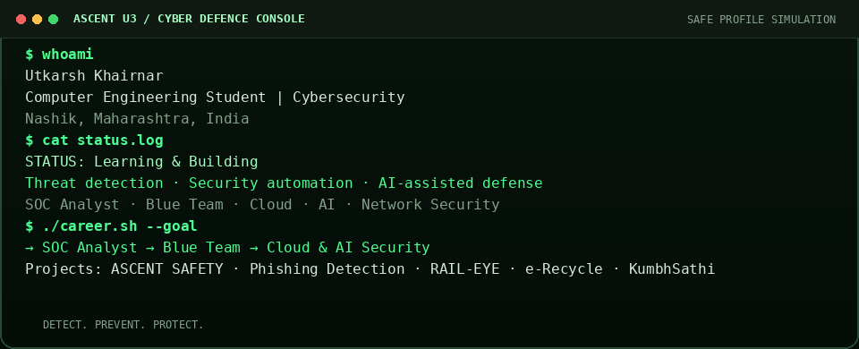
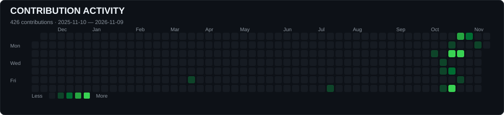

<div align="center">



<a href="https://uskascent-svg.github.io/uskascent-svg/terminal.html" title="Open the fully interactive ASCENT U3 terminal"></a>

<h1 align="center">Utkarsh S Khairnar</h1>

**Information Technology Engineering Student | Cybersecurity**

Cybersecurity · Cloud Computing · Threat Detection · AI Security · IT Infrastructure

Nashik, Maharashtra, India · IST (UTC+5:30)

[](https://www.linkedin.com/in/utkarsh-khairnar-7a467237b/)
[](https://leetcode.com/u/AscentU3/)
[](mailto:uskascent@gmail.com?subject=Opportunity%20from%20GitHub%20profile)
[](https://ascent-u3-portfolio.lovable.app)

</div>

---

## 🔹 Contribution Activity

<p align="center">
  
</p>

## 🔹 `❯ ./leetcode --profile`

Problem solving is **built on trust. Driven by results.**

**[LeetCode profile · AscentU3](https://leetcode.com/u/AscentU3/)**

## 🔹 `❯ ./play --profile`

**[Launch the ASCENT U3 Interactive Terminal ↗](https://uskascent-svg.github.io/uskascent-svg/terminal.html)** — explore my background, cybersecurity interests, projects, current learning goals, career direction, and contact links. This is a safe, simulated terminal; it does not run real shell commands or security scans.

## 🔹 `❯ ls ~/projects --featured`

| Project | Repository | What it does |
|---|---|---|
| **ASCENT SAFETY** | [Open repository ↗](https://github.com/uskascent-svg/Ascent-Safety-) | Cybersecurity analysis and threat-detection platform. |
| **Shop Agent** | [Open repository ↗](https://github.com/uskascent-svg/Utkarsh-Raju-shop-agent) | AI-powered shopping agent project. |
| **Black Hole Simulation** | [Open repository ↗](https://github.com/uskascent-svg/black_hole) | C++/OpenGL exploration of gravitational lensing and GPU-assisted simulation; based on the upstream project by [kavan010](https://github.com/kavan010/black_hole). |

## 🔹 `❯ ls ~/stack`

```bash
CYBERSECURITY/   Wazuh, SOC-operations, threat-detection, vulnerability-assessment
NETWORKING/      network-security, DNS, TCP/IP, OSI, TLS-HTTPS, VPNs
DEVELOPMENT/     Python, C++, Java, JavaScript, TypeScript, React, Node.js, FastAPI, Flask
BACKEND/         SQLAlchemy, REST-APIs (learning), Postman (learning)
DATABASES/       MySQL, PostgreSQL, MongoDB, Redis (learning)
CLOUD/           AWS, Azure, Google-Cloud, cloud-CLI-tools
INFRASTRUCTURE/  Docker, Kubernetes, Terraform, Ansible, Linux, Bash
DEVOPS/          CI-CD, GitHub-Actions, Git, GitHub, pytest
AI-VISION/       YOLO, PyTorch, Google-ADK, Antigravity
DEVELOPER-TOOLS/ VS-Code, Visual-Studio
PAYMENTS/        Razorpay, Stripe
SECURITY-LABS/   Kali-Linux
```

<p align="center">
  
</p>

## 🔹 `❯ ./stats --live`

<p align="center">
  
</p>

```console
utkarsh@cloud:~$ language-stats --source github
> source: public repositories
> display: language share + percentage
> refresh: generated dynamically by stats service
> note: percentages represent repository code, not skill level
utkarsh@cloud:~$ _
```

## 🔹 `❯ cat ~/skills.md`

- **Cybersecurity:** Wazuh, SOC operations, threat detection and vulnerability assessment.
- **Networking:** Network security fundamentals, DNS, TCP/IP, TLS/HTTPS and VPNs.
- **Development:** Python, C++, Java, JavaScript, TypeScript, React, Node.js, FastAPI and Flask.
- **Cloud & infrastructure:** AWS, Microsoft Azure, Google Cloud, cloud CLI tools, Docker, Kubernetes, Terraform, Ansible, Linux and Bash.
- **DevOps & collaboration:** CI/CD, GitHub Actions, Git and GitHub.
- **Databases & testing:** MySQL, PostgreSQL, MongoDB and pytest.
- **AI & computer vision:** YOLO, PyTorch, Google ADK and Antigravity.
- **Developer tools & payments:** VS Code, Visual Studio, Razorpay and Stripe.
- **Currently learning:** R, Redis, automated testing, REST APIs, Postman, Parrot OS and Raspberry Pi.

I focus on connecting skills to reproducible labs, repositories, tests and write-ups rather than listing unverified credentials.

## 🔹 `❯ tail -f ~/learning.log`

```text
[building] Cloud computing, Linux, networking and automation
[building] Security analysis and detection engineering
[next]     SOC workflows, cloud security and infrastructure-as-code
[always]   Documenting evidence, tests and limitations
```

## 🔹 About Me

I am an Information Technology Engineering student at MET BKC IOE, Nashik, interested in cybersecurity, SOC operations, threat detection, network security, vulnerability assessment, cloud computing and AI-assisted security.

I enjoy turning what I learn into practical projects and security solutions. My work and learning focus on Python, Linux, networking, web security, Wazuh and AI/ML. One project I am especially proud of is my Email Phishing Detection System, where I explored phishing techniques and built a system to analyze emails, links and suspicious patterns.

I believe in learning cybersecurity through hands-on projects, CTFs, labs, testing and clear technical documentation.

**Career direction:** Build a strong foundation as a SOC Analyst, then grow toward cloud security and AI-assisted security engineering.

I am interested in cybersecurity internships and project opportunities where I can apply my skills, contribute to practical challenges and learn from experienced professionals.

## 🔹 `❯ ssh collab@utkarsh`

<div align="center">

**Let's connect**

[LinkedIn](https://www.linkedin.com/in/utkarsh-khairnar-7a467237b/) · [LeetCode](https://leetcode.com/u/AscentU3/) · [Email](mailto:uskascent@gmail.com) · [Portfolio](https://ascent-u3-portfolio.lovable.app)

**Detect. Prevent. Protect.**

*Curious by default. Security-minded by design.*

</div>
