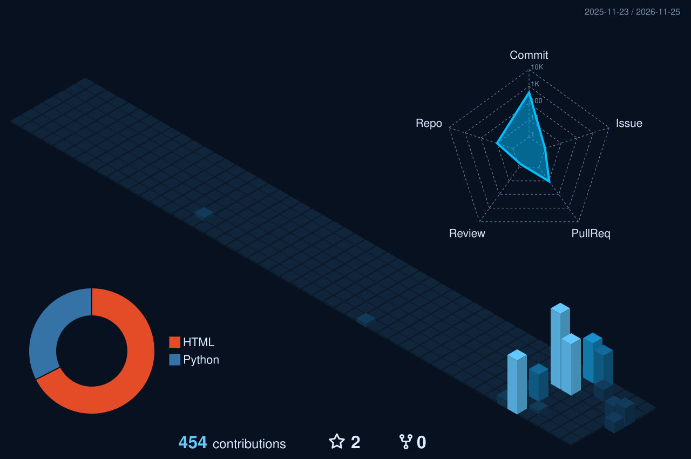

<div align="center">
  
</div>

<a href="https://uskascent-svg.github.io/uskascent-svg/terminal.html" title="Open the fully interactive ASCENT U3 terminal"></a>

---

## 🔹 `❯ ./contributions --city`

<p align="center">
  
</p>

<p align="center">
  <sub>365-day contribution landscape</sub>
</p>

## 🔹 `❯ ./contributions --snake`

<p align="center">
  <picture>
    <source media="(prefers-color-scheme: dark)" srcset="https://raw.githubusercontent.com/uskascent-svg/uskascent-svg/output/github-contribution-grid-snake-dark.svg"/>
    <source media="(prefers-color-scheme: light)" srcset="https://raw.githubusercontent.com/uskascent-svg/uskascent-svg/output/github-contribution-grid-snake.svg"/>
    
  </picture>
</p>

## 🔹 `❯ ./stats --github`

<p align="center">
  
  
</p>

<p align="center">
  <sub>Stats are generated by their respective services; GitHub contribution data may take time to refresh.</sub>
</p>

## 🔹 `❯ ./leetcode --profile`

Problem solving is **built on trust. Driven by results.**
Curiosity fuels the challenges Logic drives the solution.

<p align="center">
  <a href="https://leetcode.com/u/AscentU3/" title="Open LeetCode profile — AscentU3" target="_blank" rel="noopener noreferrer">
    
  </a>
</p>

## 🔹 `❯ ./play --profile`

**[Launch the ASCENT U3 Interactive Terminal ↗](https://uskascent-svg.github.io/uskascent-svg/terminal.html)** — explore my background

## 🔹 `❯ ls ~/projects --featured`

Selected projects, with concise summaries, technology stacks, and available links.

| Project | What it does | Technology stack | Demo | Source code |
|---|---|---|---|---|
| **ASCENT SAFETY** | AI-assisted cybersecurity monitoring and threat analysis. | Next.js, React, TypeScript, Tailwind CSS, Python, FastAPI, PostgreSQL, SQLAlchemy | [Live Demo](https://ascent-safety-web.onrender.com) | [Repository](https://github.com/uskascent-svg/Ascent-Safety-) |
| **E-Cycle** | Community-driven e-waste collection and recycling management. | HTML, CSS, JavaScript, Python, Flask, SQLite | [Live Demo](https://e-cycle-xyv5.onrender.com) | [Repository](https://github.com/uskascent-svg/E-cycle) |
| **Raju's Royal Artifacts** | Gemini-powered conversational shopping and bargaining agent. | Python, Google Gemini, Google ADK, FastAPI, HTML, CSS, JavaScript | Local demo | [Repository](https://github.com/uskascent-svg/Utkarsh-Raju-shop-agent) |
| **Black Hole Simulation** | Interactive black-hole physics and gravitational lensing visualisation. | C++, OpenGL, GLEW, GLFW, GLM, CMake, GPU shaders | Local demo | [Repository](https://github.com/uskascent-svg/black_hole) |
| **SOC-IO** | Offline-first security event ingestion, detection, and triage. | Python, SQLite, JSONL, Windows Sysmon, CLI, unittest | Local prototype | [Repository](https://github.com/uskascent-svg/soc-io) |
| **AscentIntegrity** | Cryptographic evidence integrity, verification, and audit tracking. | React, TypeScript, Python, FastAPI, PostgreSQL, SQLAlchemy, Alembic, SHA-256, EVM | Local demo | [Repository](https://github.com/uskascent-svg/AscentIntegrity) |

## 🔹 `❯ ls ~/stack`

```bash
CYBERSECURITY/   Wazuh, SOC-operations, threat-detection, vulnerability-assessment
NETWORKING/      network-security, DNS, TCP/IP, OSI, TLS-HTTPS, VPNs
DEVELOPMENT/     Python, C++, Java, JavaScript, TypeScript, React, Node.js, FastAPI, Flask
BACKEND/         SQLAlchemy, REST-APIs (learning), Postman (learning)
DATABASES/       MySQL, PostgreSQL, MongoDB, Redis (learning)
CLOUD/           AWS, Azure, Google-Cloud, cloud-CLI-tools
INFRASTRUCTURE/  Docker, Kubernetes, Terraform, Ansible, Linux, Bash
DEVOPS/          CI-CD, GitHub-Actions, Git, GitHub, pytest
AI-VISION/       YOLO, PyTorch, Google-ADK, Antigravity
DEVELOPER-TOOLS/ VS-Code, Visual-Studio
PAYMENTS/        Razorpay, Stripe
SECURITY-LABS/   Kali-Linux
```

<p align="center">
  
</p>

## 🔹 `❯ ./stats --live`

<p align="center">
  
</p>

```console
utkarsh@cloud:~$ language-stats --source github
> source: public repositories
> display: language share + percentage
> refresh: generated dynamically by stats service
> note: percentages represent repository code, not skill level
utkarsh@cloud:~$ _
```

## 🔹 `❯ cat ~/skills.md`

- **Cybersecurity:** Wazuh, SOC operations, threat detection and vulnerability assessment.
- **Networking:** Network security fundamentals, DNS, TCP/IP, TLS/HTTPS and VPNs.
- **Development:** Python, C++, Java, JavaScript, TypeScript, React, Node.js, FastAPI and Flask.
- **Cloud & infrastructure:** AWS, Microsoft Azure, Google Cloud, cloud CLI tools, Docker, Kubernetes, Terraform, Ansible, Linux and Bash.
- **DevOps & collaboration:** CI/CD, GitHub Actions, Git and GitHub.
- **Databases & testing:** MySQL, PostgreSQL, MongoDB and pytest.
- **AI & computer vision:** YOLO, PyTorch, Google ADK and Antigravity.
- **Developer tools & payments:** VS Code, Visual Studio, Razorpay and Stripe.
- **Currently learning:** R, Redis, automated testing, REST APIs, Postman, Parrot OS and Raspberry Pi.

I focus on connecting skills to reproducible labs, repositories, tests and write-ups rather than listing unverified credentials.

## 🔹 `❯ tail -f ~/learning.log`

```text
[building] Cloud computing, Linux, networking and automation
[building] Security analysis and detection engineering
[next]     SOC workflows, cloud security and infrastructure-as-code
[always]   Documenting evidence, tests and limitations
```

## 🔹 About Me

I am an Information Technology Engineering student at MET BKC IOE, Nashik, interested in cybersecurity, SOC operations, threat detection, network security, vulnerability assessment, cloud computing and AI-assisted security.

I enjoy turning what I learn into practical projects and security solutions. My work and learning focus on Python, Linux, networking, web security, Wazuh and AI/ML. One project I am especially proud of is my Email Phishing Detection System, where I explored phishing techniques and built a system to analyze emails, links and suspicious patterns.

I believe in learning cybersecurity through hands-on projects, CTFs, labs, testing and clear technical documentation.

**Career direction:** Build a strong foundation as a SOC Analyst, then grow toward cloud security and AI-assisted security engineering.

I am interested in cybersecurity internships and project opportunities where I can apply my skills, contribute to practical challenges and learn from experienced professionals.

## 🔹 `❯ ssh collab@utkarsh`

<div align="center">

### Let's connect

<a href="https://www.linkedin.com/in/utkarsh-khairnar-7a467237b/" title="Connect on LinkedIn"></a>&nbsp;
<a href="https://leetcode.com/u/AscentU3/" title="View LeetCode profile"></a>&nbsp;
<a href="mailto:uskascent@gmail.com" title="Send an email"></a>&nbsp;
<a href="https://ascent-u3-portfolio.lovable.app" title="Explore portfolio"></a>

**DETECT. PREVENT. PROTECT.**

*Curious by default. Security-minded by design.*

</div>
