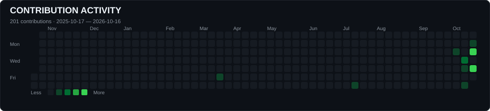

<div align="center">


<a href="https://uskascent-svg.github.io/uskascent-svg/terminal.html" title="Open the fully interactive ASCENT U3 terminal"></a>


<p align="center">
</p>
<h1 align="center">Utkarsh S Khairnar</h1>

Cybersecurity · Cloud Computing · Cloud Security                
 AI · Development 

Nashik, India · IST (UTC+5:30)

[](https://www.linkedin.com/in/utkarsh-khairnar-7a467237b/)
[](https://leetcode.com/u/AscentU3/)
[](mailto:uskascent@gmail.com?subject=Opportunity%20from%20GitHub%20profile)
[](https://ascent-u3-portfolio.lovable.app)

</div>

<h1 align="center">Contribution Activity</h1>

<p align="center">
  
</p>

## `❯ ./leetcode --profile`

Problem solving is **built on trust. Driven by results.**

**[LeetCode profile · AscentU3](https://leetcode.com/u/AscentU3/)**

## `❯ ./play --profile`

**[Launch the ASCENT U3 Interactive Terminal ↗](https://uskascent-svg.github.io/uskascent-svg/terminal.html)** — enter commands to explore my background, cybersecurity interests, projects, current learning goals, career direction, and contact links. This is one safe, simulated terminal experience; it does not run real shell commands or security scans.

## `❯ ls ~/projects --featured`

| Project | Repository | What it does |
|---|---|---|
| **ASCENT SAFETY** | [Open repository ↗](https://github.com/uskascent-svg/Ascent-Safety-) | Cybersecurity analysis and threat-detection platform. |
| **Shop Agent** | [Open repository ↗](https://github.com/uskascent-svg/Utkarsh-Raju-shop-agent) | AI-powered shopping agent project. |
| **Black Hole Simulation** | [Open repository ↗](https://github.com/uskascent-svg/black_hole) | C++/OpenGL exploration of gravitational lensing and GPU-assisted simulation; based on the upstream project by [kavan010](https://github.com/kavan010/black_hole). |

## `❯ ls ~/stack`

```bash
drwxr-xr-x  security/  soc  threat-detection  siem  vulnerability-assessment  network-security
drwxr-xr-x  systems/   linux  bash  python  docker
drwxr-xr-x  development/  python  cpp  java  javascript  typescript  sql
```

<p align="center">
  
</p>

## `❯ ./stats --live`

<p align="center">
  
</p>

```console
utkarsh@cloud:~$ language-stats --source github
> source: public repositories
> display: language share + percentage
> refresh: generated dynamically by stats service
> note: percentages represent repository code, not skill level
utkarsh@cloud:~$ _
```

## `❯ cat ~/skills.md`

- **Cloud:** AWS and Azure fundamentals, IAM, networking and Terraform labs.
- **Security:** Cloud computing concepts, SIEM, vulnerability analysis and threat modelling.
- **Systems:** Linux, Docker, Bash and Python.
- **Problem solving:** [LeetCode · AscentU3](https://leetcode.com/u/AscentU3/).

I aim to connect skills to reproducible labs, repositories, tests or write-ups instead of listing unverified credentials.

## `❯ tail -f ~/learning.log`

```text
[building] Cloud, Linux, networking and automation
[building] Security analysis and detection engineering
[next]     Hardening CI/CD and infrastructure-as-code
[always]   Documenting evidence, tests and limitations
```

## About Me

I am an Information Technology Engineering Student at MET BKC IOE Nashik and i am passionate about Cybersecurity, SOC Operations, Threat Detection, Network Security, Vulnerability Assessment, and Al-driven security.

I enjoy turning what I learn into practical security solutions. I've worked with Python, Linux, networking, web security, SIEM, and AI/ ML. One project I'm especially proud of is my Email Phishing Detection System, where I explored real-world phishing techniques and built a system to analyze emails, links, and suspicious patterns. The project strengthened my ability to think like both an attacker and a defender, turning security concepts into practical threat-detection solutions.

I believe in learning cybersecurity through hands-on projects, CTFs, labs, and real-world problem solving.

Career Goal: To become a Cybersecurity/SOC Analyst and grow into Security and Threat Intelligence.

Currently seeking cybersecurity internships and project opportunities where I can apply my skills, contribute to real-world security challenges, and learn from experienced professionals.

## `❯ ssh collab@utkarsh`

<div align="center">

**Let's connect**

[LinkedIn](https://www.linkedin.com/in/utkarsh-khairnar-7a467237b/) · [LeetCode](https://leetcode.com/u/AscentU3/) · [Email](mailto:uskascent@gmail.com)

*Curious by default. Security-minded by design.*

</div>
