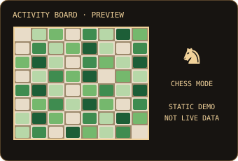

<div align="center">

# Utkarsh Khairnar

**Building safer cloud workloads | Cybersecurity · Blue Team · Cloud**

[](https://www.linkedin.com/in/utkarsh-khairnar-7a467237b/)
[](https://leetcode.com/u/AscentU3/)
[](https://github.com/uskascent-svg)
[](mailto:uskas@gmail.com?subject=Opportunity%20from%20GitHub%20profile)

*IT Engineering student building practical security tools, cloud labs and automation—with evidence, tests and clear limitations.*

</div>

---

## `❯ ./chessboard --activity`

<p align="center">
  
</p>

A chess-inspired take on the contribution grid. The board artwork is currently a visual placeholder; live contribution mapping and issue-driven chess moves will be added only when their workflows and validation tests are in place.

## `❯ ./leetcode --profile`

**[View LeetCode profile →](https://leetcode.com/u/AscentU3/)**

LeetCode profile stats are available at the source. Automated stat syncing and a self-hosted card are planned; no cached or simulated numbers are shown here.

## `❯ ls ~/projects --featured`

| Project | Focus | Stack / status |
|---|---|---|
| **[ASCENT SAFETY](https://github.com/uskascent-svg/Ascent-Safety-)** | Explainable analysis of suspicious files, text and URLs. | Python · FastAPI · Security analysis — active development |
| **RAIL-EYE** | Vision-assisted railway intrusion detection and alerting. | Computer vision · FastAPI · React — prototype |
| **TinyGPT / SLM** | Compact language-model training and text generation experiments. | PyTorch · NLP · FastAPI — learning project |

## `❯ cat ~/skills.md`

- **Cloud:** AWS/Azure, IAM, networking and Terraform — building hands-on labs.
- **Security:** blue-team fundamentals, SIEM concepts, vulnerability analysis and threat modelling.
- **Systems:** Linux, Docker, Bash and Python.
- **Problem solving:** [LeetCode · AscentU3](https://leetcode.com/u/AscentU3/).

I aim to connect each skill to a reproducible lab, repository, test, or write-up rather than list unverified credentials. No certifications are listed until earned.

## `❯ tail -f ~/learning.log`

```text
[building] Practising cloud, Linux, networking and automation
[building] Improving security analysis and detection engineering
[next]     Hardening CI/CD and infrastructure-as-code workflows
[always]   Documenting evidence, tests and limitations
```

## Security-minded engineering

| Risk | Engineering principle |
|---|---|
| Untrusted input | Validate against strict allowlists and avoid shell interpolation |
| Spoofing and abuse | Verify identity, permissions, rate limits and legal state transitions |
| Concurrent updates | Serialize writes and handle stale state safely |
| External API failure | Use timeouts, validate schemas and preserve known-good cached data |
| Supply-chain risk | Pin workflow dependencies, use lockfiles and review automated updates |
| Misleading metrics | Show measured results only; label placeholders and limitations clearly |

## `❯ ssh collab@utkarsh`

<div align="center">

**Let's connect**

[LinkedIn](https://www.linkedin.com/in/utkarsh-khairnar-7a467237b/) · [LeetCode](https://leetcode.com/u/AscentU3/) · [Send an email](mailto:uskas@gmail.com?subject=Opportunity%20from%20GitHub%20profile)

*Curious by default. Security-minded by design.*

</div>
