<div align="center">

<pre>
██╗   ██╗████████╗██╗  ██╗ █████╗ ██████╗ ███████╗██╗  ██╗
██║   ██║╚══██╔══╝██║ ██╔╝██╔══██╗██╔══██╗██╔════╝██║  ██║
██║   ██║   ██║   █████╔╝ ███████║██████╔╝███████╗███████║
██║   ██║   ██║   ██╔═██╗ ██╔══██║██╔══██╗╚════██║██╔══██║
╚██████╔╝   ██║   ██║  ██╗██║  ██║██║  ██║███████║██║  ██║
 ╚═════╝    ╚═╝   ╚═╝  ╚═╝╚═╝  ╚═╝╚═╝  ╚═╝╚══════╝╚═╝  ╚═╝
</pre>



**Utkarsh Khairnar**

Cybersecurity · Blue Team · Cloud Security · AI Security

Nashik, India · IST (UTC+5:30)

[](https://www.linkedin.com/in/utkarsh-khairnar-7a467237b/)
[](https://leetcode.com/u/AscentU3/)
[](mailto:uskascent@gmail.com?subject=Opportunity%20from%20GitHub%20profile)

</div>
---

<h1 align="center">Contribution Activity</h1>

<p align="center">
  
</p>


## `❯ ./leetcode --profile`

Problem solving is **built on trust. Driven by results.**

**[LeetCode · AscentU3](https://leetcode.com/u/AscentU3/)**

## `❯ ls ~/projects --featured`

| Project | Repository | What it does |
|---|---|---|
| **ASCENT SAFETY** | [Open repository ↗](https://github.com/uskascent-svg/Ascent-Safety-) | Cybersecurity analysis and threat-detection platform. |
| **Shop Agent** | [Open repository ↗](https://github.com/uskascent-svg/Utkarsh-Raju-shop-agent) | AI-powered shopping agent project. |
| **LeetCode Solutions** | [Open repository ↗](https://github.com/uskascent-svg/Leetcode-solution-) | Repository for coding practice and problem solutions. |

## `❯ languages --list`

<div align="center">

```bash
utkarsh@cloud:~$ figlet -f small "languages"
```

<a href="https://www.python.org/"></a>
<a href="https://isocpp.org/"></a>
<a href="https://www.java.com/"></a>
<a href="https://developer.mozilla.org/en-US/docs/Web/JavaScript"></a>
<a href="https://www.typescriptlang.org/"></a>
<a href="https://www.mysql.com/"></a>
<a href="https://www.gnu.org/software/bash/"></a>

```text
utkarsh@cloud:~$ languages --status
[active]   Python       | Security scripts & automation
[learning] C++          | Data structures & algorithms
[learning] Java         | Object-oriented programming
[building] JavaScript   | Web development
[building] TypeScript   | Typed application development
[practice] SQL          | Database queries
[active]   Bash         | Linux command line
utkarsh@cloud:~$ _
```

</div>

## `❯ cat ~/skills.md`

- **Cloud:** AWS and Azure fundamentals, IAM, networking and Terraform labs.
- **Security:** Blue-team concepts, SIEM, vulnerability analysis and threat modelling.
- **Systems:** Linux, Docker, Bash and Python.
- **Problem solving:** [LeetCode · AscentU3](https://leetcode.com/u/AscentU3/).

I aim to connect skills to reproducible labs, repositories, tests or write-ups instead of listing unverified credentials.

## `❯ tail -f ~/learning.log`

```text
[building] Cloud, Linux, networking and automation
[building] Security analysis and detection engineering
[next]     Hardening CI/CD and infrastructure-as-code
[always]   Documenting evidence, tests and limitations
```

## About Me

I am an IT Engineering student at MET BKC IOE Nashik and i am passionate about Cybersecurity, SOC Operations, Threat Detection, Network Security, Vulnerability Assessment, and Al-driven security.

I enjoy turning what I learn into practical security solutions. I've worked with Python, Linux, networking, web security, SIEM, and AI/ ML. One project I'm especially proud of is my Email Phishing Detection System, where I explored real-world phishing techniques and built a system to analyze emails, links, and suspicious patterns. The project strengthened my ability to think like both an attacker and a defender, turning security concepts into practical threat-detection solutions.

I believe in learning cybersecurity through hands-on projects, CTFs, labs, and real-world problem solving.

Career Goal: To become a Cybersecurity/SOC Analyst and grow into Security and Threat Intelligence.

Currently seeking cybersecurity internships and project opportunities where I can apply my skills, contribute to real-world security challenges, and learn from experienced professionals.

## `❯ ssh collab@utkarsh`

<div align="center">

**Let's connect**

[LinkedIn](https://www.linkedin.com/in/utkarsh-khairnar-7a467237b/) · [LeetCode](https://leetcode.com/u/AscentU3/) · [Email](mailto:uskascent@gmail.com)

*Curious by default. Security-minded by design.*

</div>
