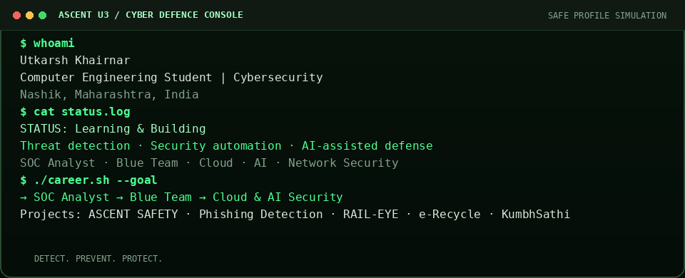
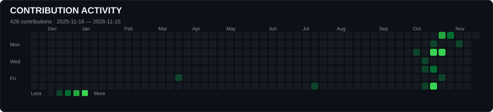

<div align="center">
  
</div>

<a href="https://uskascent-svg.github.io/uskascent-svg/terminal.html" title="Open the fully interactive ASCENT U3 terminal"></a>

---

## 🔹 Contribution Activity

<p align="center">
  
</p>

## 🔹 `❯ ./leetcode --profile`

Problem solving is **built on trust. Driven by results.**

**[LeetCode profile · AscentU3](https://leetcode.com/u/AscentU3/)**

## 🔹 `❯ ./play --profile`

**[Launch the ASCENT U3 Interactive Terminal ↗](https://uskascent-svg.github.io/uskascent-svg/terminal.html)** — explore my background, cybersecurity interests, projects, current learning goals, career direction, and contact links. This is a safe, simulated terminal; it does not run real shell commands or security scans.

## 🔹 `❯ ls ~/projects --featured`

A selection of my existing and newer projects. Each description is **100 words**; live demos are linked only where a deployed URL is documented.

### ASCENT SAFETY

ASCENT SAFETY is a modular cybersecurity monitoring and threat-analysis platform built to support practical security operations. It brings suspicious-content analysis, phishing detection, security-event review, threat-intelligence enrichment, endpoint telemetry, alerts, reports, and case workflows into one interface. The platform combines a Next.js frontend, FastAPI services, and PostgreSQL persistence, with explainable detection logic and controlled machine-learning evaluation. Authorized users can investigate findings, review event timelines, and manage security reports, while administrators oversee integrations and operational activity. Its design emphasizes evidence-based results, privacy-aware handling, auditable actions, and honest reporting: unavailable telemetry or unverified detection metrics are never presented as confirmed security outcomes. responsibly

[Live Demo ↗](https://ascent-safety-web.onrender.com) · [GitHub Repository ↗](https://github.com/uskascent-svg/Ascent-Safety-)

### E-Cycle

E-Cycle is a community-focused e-waste collection and circular-economy platform that encourages responsible disposal, reuse, repair, donation, refurbishment, and recycling. Users can register unwanted electronic devices, submit collection requests, receive tracking updates, and follow the journey of their items. The platform supports pickup scheduling, service-area and capacity checks, distributor assignment, facility intake, processing records, community drives, rewards, certificates, and an AI assistant when configured. Administrators manage users, submissions, distributors, facilities, operations, reports, and security activity through dedicated workflows. Built with HTML, CSS, JavaScript, Flask, and SQLite, it aims to make electronic-waste handling more transparent, organized, and accessible for local communities today.

[Live Demo ↗](https://e-cycle-xyv5.onrender.com) · [GitHub Repository ↗](https://github.com/uskascent-svg/E-cycle)

### Raju's Royal Artifacts (Shop Agent)

Raju's Royal Artifacts is an interactive AI-powered bargaining shopkeeper experience inspired by an Indian digital bazaar. A conversational agent named Raju welcomes customers, discusses products, negotiates prices, and checks stock through a Python inventory function. The application uses Google's Gemini model and Agent Development Kit, with a FastAPI runtime and a responsive glassmorphism storefront. Its features include a distinctive shopkeeper personality, real-time tool calling, stock-aware responses, sold-out handling, stateful chat sessions, and a visual product shelf. The repository includes setup scripts, API documentation, and automated tests. It is designed as a locally runnable demonstration; no public production demo is claimed.

[GitHub Repository ↗](https://github.com/uskascent-svg/Utkarsh-Raju-shop-agent)

### Black Hole Simulation

Black Hole Simulation explores the visual physics of black holes through C++ and OpenGL. The repository includes a two-dimensional gravitational-lensing visualization and a three-dimensional GPU-assisted simulation that uses a compute shader for geodesic calculations. It provides a hands-on way to explore how light paths can bend around an extreme gravitational object, combining mathematical ideas with real-time graphics programming. The project uses a C++17-compatible toolchain, CMake, and graphics dependencies such as GLEW, GLFW, and GLM, with Vcpkg documented for dependency management. This repository is based on the upstream work by kavan010, whose authorship and attribution are retained in documentation and credits.

[GitHub Repository ↗](https://github.com/uskascent-svg/black_hole)

### SOC-IO

SOC-IO is an experimental, offline-first security-event triage toolkit created for cybersecurity learning and authorized lab validation. It ingests normalized JSONL events, applies transparent deterministic detection rules, and can optionally collect recent Windows Sysmon events through a read-only workflow. Analysis runs can be stored locally in SQLite, while a lightweight dashboard displays generated JSON reports without making network requests. The repository also includes unit tests, a synthetic rule-regression evaluation harness, and documentation for collection, persistence, and security boundaries. SOC-IO is intentionally presented as a prototype, not a production SIEM; rule matches are investigation leads, not proof of compromise, for analyst training.

[GitHub Repository ↗](https://github.com/uskascent-svg/soc-io)

### AscentIntegrity

AscentIntegrity is a cybersecurity-focused evidence-integrity platform designed to record and verify digital evidence using cryptographic hashes. Its workflow calculates SHA-256 digests during evidence intake, stores version records, records audit events, and can optionally anchor digests to an EVM-compatible blockchain. A React and TypeScript dashboard connects to a FastAPI backend, with PostgreSQL models and Alembic migrations supporting structured records. Verification re-hashes stored files and checks configured blockchain anchors before an integrity certificate can be issued. The project distinguishes byte integrity from factual truth and documents important development-stage limitations, including authorization, storage immutability, and production key management for secure evidence workflows today.

[GitHub Repository ↗](https://github.com/uskascent-svg/AscentIntegrity)

## 🔹 `❯ ls ~/stack`

```bash
CYBERSECURITY/   Wazuh, SOC-operations, threat-detection, vulnerability-assessment
NETWORKING/      network-security, DNS, TCP/IP, OSI, TLS-HTTPS, VPNs
DEVELOPMENT/     Python, C++, Java, JavaScript, TypeScript, React, Node.js, FastAPI, Flask
BACKEND/         SQLAlchemy, REST-APIs (learning), Postman (learning)
DATABASES/       MySQL, PostgreSQL, MongoDB, Redis (learning)
CLOUD/           AWS, Azure, Google-Cloud, cloud-CLI-tools
INFRASTRUCTURE/  Docker, Kubernetes, Terraform, Ansible, Linux, Bash
DEVOPS/          CI-CD, GitHub-Actions, Git, GitHub, pytest
AI-VISION/       YOLO, PyTorch, Google-ADK, Antigravity
DEVELOPER-TOOLS/ VS-Code, Visual-Studio
PAYMENTS/        Razorpay, Stripe
SECURITY-LABS/   Kali-Linux
```

<p align="center">
  
</p>

## 🔹 `❯ ./stats --live`

<p align="center">
  
</p>

```console
utkarsh@cloud:~$ language-stats --source github
> source: public repositories
> display: language share + percentage
> refresh: generated dynamically by stats service
> note: percentages represent repository code, not skill level
utkarsh@cloud:~$ _
```

## 🔹 `❯ cat ~/skills.md`

- **Cybersecurity:** Wazuh, SOC operations, threat detection and vulnerability assessment.
- **Networking:** Network security fundamentals, DNS, TCP/IP, TLS/HTTPS and VPNs.
- **Development:** Python, C++, Java, JavaScript, TypeScript, React, Node.js, FastAPI and Flask.
- **Cloud & infrastructure:** AWS, Microsoft Azure, Google Cloud, cloud CLI tools, Docker, Kubernetes, Terraform, Ansible, Linux and Bash.
- **DevOps & collaboration:** CI/CD, GitHub Actions, Git and GitHub.
- **Databases & testing:** MySQL, PostgreSQL, MongoDB and pytest.
- **AI & computer vision:** YOLO, PyTorch, Google ADK and Antigravity.
- **Developer tools & payments:** VS Code, Visual Studio, Razorpay and Stripe.
- **Currently learning:** R, Redis, automated testing, REST APIs, Postman, Parrot OS and Raspberry Pi.

I focus on connecting skills to reproducible labs, repositories, tests and write-ups rather than listing unverified credentials.

## 🔹 `❯ tail -f ~/learning.log`

```text
[building] Cloud computing, Linux, networking and automation
[building] Security analysis and detection engineering
[next]     SOC workflows, cloud security and infrastructure-as-code
[always]   Documenting evidence, tests and limitations
```

## 🔹 About Me

I am an Information Technology Engineering student at MET BKC IOE, Nashik, interested in cybersecurity, SOC operations, threat detection, network security, vulnerability assessment, cloud computing and AI-assisted security.

I enjoy turning what I learn into practical projects and security solutions. My work and learning focus on Python, Linux, networking, web security, Wazuh and AI/ML. One project I am especially proud of is my Email Phishing Detection System, where I explored phishing techniques and built a system to analyze emails, links and suspicious patterns.

I believe in learning cybersecurity through hands-on projects, CTFs, labs, testing and clear technical documentation.

**Career direction:** Build a strong foundation as a SOC Analyst, then grow toward cloud security and AI-assisted security engineering.

I am interested in cybersecurity internships and project opportunities where I can apply my skills, contribute to practical challenges and learn from experienced professionals.

## 🔹 `❯ ssh collab@utkarsh`

<div align="center">

**Let's connect**

[LinkedIn](https://www.linkedin.com/in/utkarsh-khairnar-7a467237b/) · [LeetCode](https://leetcode.com/u/AscentU3/) · [Email](mailto:uskascent@gmail.com) · [Portfolio](https://ascent-u3-portfolio.lovable.app)

**Detect. Prevent. Protect.**

*Curious by default. Security-minded by design.*

</div>
